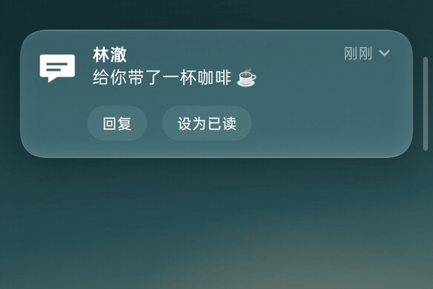
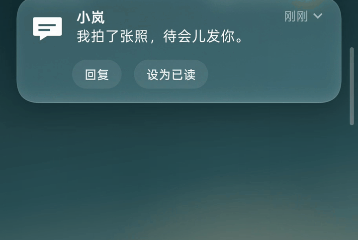

# ShadeReply · 通知快捷回复

面向 ColorOS 的独立 LSPosed 模块，已在 ColorOS 17 上验证。长按或下拉一条支持 Android 原生文字回复的通知，可以直接在顶部横幅或通知栏打开回复框。

[下载 APK](https://github.com/Xinhuaaa/shadereply/releases) · [源码许可](LICENSE) · [第三方许可](NOTICE.md)

| 横幅下拉、上滑收起与关闭 | 横幅长按打开回复框 | 通知栏长按打开回复框 |
| --- | --- | --- |
|  |  |  |

*ColorOS 17 实机录屏，使用模拟聊天消息。白色圆点标出手指位置。*

## 手势

| 位置 | 操作 | 效果 |
| --- | --- | --- |
| 顶部通知横幅 | 长按或下拉卡片 | 在横幅内打开回复框 |
| 已展开的横幅 | 上滑卡片 | 收起展开内容，背景模糊随手势减弱 |
| 刚收起的横幅 | 再上滑一次 | 整张横幅跟手上移，拖过门槛后松手收走 |
| 通知栏 | 长按或下拉通知卡片 | 在卡片原位展开回复框，切换到另一条时收起上一条 |

横幅手势覆盖横屏和竖屏。下拉顶部横幅时，卡片跟手拉伸、下移并回弹。通知栏中的卡片原位展开回复框和历史内容。

竖屏横幅中的「回复」圆角区域会展开成输入栏，发送按钮随后从栏内向右弹出。上滑收起时按相反方向过渡，并恢复显示该通知原有的操作按钮。

## 安装与作用域

APK 最低安装版本为 **Android 16（API 36）**。启用模块需要支持 **Modern Xposed API 102** 的 LSPosed。模块包名为 `io.shadereply`。

1. 从 [GitHub Releases](https://github.com/Xinhuaaa/shadereply/releases) 下载 APK 并安装。
2. 在 LSPosed 的模块列表里启用「通知快捷回复」，按需勾选下表中的作用域。
3. 从 LSPosed 的模块列表或桌面打开设置，点「重启作用域」。此操作需要 Root，也可通过重启手机重新加载模块。
4. 解锁手机后，用设置页里的「测试通知」试用手势，或接收一条提供原生文字回复的通知。

| LSPosed 作用域 | 用途 |
| --- | --- |
| 系统界面 `com.android.systemui` | 横幅和通知栏的回复手势、动画与媒体预览 |
| 微信 `com.tencent.mm` | 微信通知进化、聊天气泡与媒体处理 |

模块使用 Modern Xposed API 的入口和推荐作用域声明。设置入口支持从 LSPosed 启动，隐藏桌面图标后仍可从模块列表进入。[libxposed 模块规范](https://libxposed.github.io/api/io/github/libxposed/api/package-summary.html)

## 设置与更新

- **回复手势**可以调整长按和下拉。默认值为长按 650 毫秒、横幅下拉 45 dp、通知栏卡片下拉 87 dp。修改后点「保存设置」。
- **微信通知**集中管理通知进化、气泡、图片、贴纸和语音。微信相关功能需要勾选微信作用域。
- **模块管理**提供测试通知、隐藏桌面图标、恢复默认和重启作用域。顶部绿色「已激活」表示模块进程已加载，更新后仍在运行旧版本时会提示重启作用域。
- **关于**会检查 GitHub Releases，并就地显示更新说明和下载进度。下载完成后点「安装更新」，由 Android 确认覆盖安装。首次从 ShadeReply 安装时，系统可能要求允许此来源安装应用。安装后可在首页重启作用域加载新版。

振动模式下，开启系统触感反馈后，回复框打开时会轻震。触碰支持快捷回复的横幅会重新计算停留时间。

## 微信通知进化

在 LSPosed 中勾选「微信」并重启微信后，ShadeReply 会按设置处理微信通知。默认启用通知进化、原生聊天气泡和语音转文字。使用 ShadeReply 处理微信通知时，请关闭 WeKite 中同类的通知进化功能。

- 私聊和群聊使用 Android 对话通知，可显示头像、群聊发送者和最近 7 条消息。
- 支持直接回复、标为已读，以及隐藏「标为已读」。连续回复会逐条加入通知记录。「回复后清空收到的消息」默认关闭，开启后仍保留自己的回复。
- 图片可关闭预览、显示缩略图或优先用本地大图。贴纸可选择等待微信缓存，预览就绪后更新通知。语音转写由微信提供，转写结果会带「[语音]」标记。
- 在模块里开启「原生聊天气泡」，在「系统气泡设置」选择「仅所选对话」。写入系统气泡偏好需要 Root 授权。展开一条微信通知并点气泡图标，把该对话加入气泡。点屏幕边缘的气泡展开微信聊天页，同一对话的新消息会更新同一个气泡。

微信通知兼容性参考 [WeKite 通知进化源码](https://github.com/SymonChu/WeKite/blob/19bffe4c/app/src/main/java/com/github/wekite/features/items/notifications/NotificationsEvolved.kt)。使用的 Android 接口见 [原生通知气泡](https://developer.android.com/develop/ui/compose/notifications/bubbles)。

## 适用范围

- 按通知是否提供 Android 原生自由文本回复动作判断，适用于符合条件的微信及其他应用通知。
- 横幅和通知栏显示的消息历史取决于应用随通知提供的内容。
- ColorOS 17 已验证横幅和通知栏的回复手势。ColorOS 16 为试用支持，横幅、通知栏和全屏应用内的手势仍待实机验证。
- 微信通知进化已核对微信 8.0.78 的接口。其他微信版本、其他 ColorOS 版本及其他 ROM 的兼容性以实测为准。

## 构建

构建需要 JDK 21、Android SDK 37 和 Build Tools 37.0.0。先在项目目录执行以下命令。

```sh
git clone https://github.com/Costben/coui17.git ../coui17-main
git -C ../coui17-main checkout 7135f75aa4346fa03e589e0e41235386f309bdd8
./gradlew assembleDebug
```

Windows 可用 `gradlew.bat assembleDebug`。APK 位于 `build/outputs/apk/debug/`。可用 `-PcouiSource=路径` 指定已有的 COUI17 源码目录。

## 反馈与贡献

欢迎提交 Issue 和 PR。报告兼容性问题时，请附上手机型号、ColorOS 版本、ShadeReply 版本、LSPosed 框架版本、微信版本和复现步骤。分享日志前请遮盖聊天内容及个人信息。[Issues](https://github.com/Xinhuaaa/shadereply/issues) · [Pull Requests](https://github.com/Xinhuaaa/shadereply/pulls)

复现前在「模块管理」开启「详细日志记录」并保存。复现后从 LSPosed 的「日志」页导出 ZIP，记录复现时间。该开关默认关闭。在模块日志中搜索 `ShadeReplyTrace`，同一个 `trace=` 可以串起微信的附件处理、通知更新和系统界面的图片绑定与绘制。追踪记录使用随机标识，只包含阶段、结果、尺寸和计数等诊断信息。

## 许可

ShadeReply 采用 GNU GPL v3。微信相关接口适配参考 WeKite。第三方组件沿用各自的许可证，许可原文和版权声明也可在「关于 → 开源许可」离线查看。[GPL v3 原文](LICENSE) · [来源与许可](NOTICE.md)
