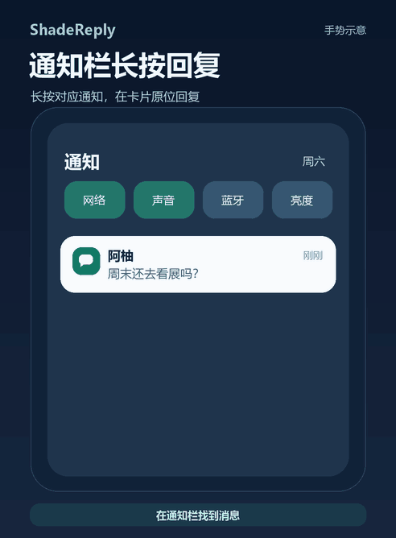

# ShadeReply · 通知快捷回复

适用于 ColorOS 17 的独立 LSPosed 模块。长按或下拉一条支持 Android 原生文字回复的通知，可以直接在顶部横幅或通知栏打开回复框。

[下载发布版 APK](https://github.com/Xinhuaaa/shadereply/releases)

| 横幅下拉、上滑收起与关闭 | 横幅长按打开回复框 | 通知栏长按并发送回复 |
| --- | --- | --- |
|  |  |  |

*ColorOS 17 实机录屏，使用模拟聊天消息。白色圆点标出手指位置。*

## 手势

| 位置 | 操作 | 效果 |
| --- | --- | --- |
| 顶部通知横幅 | 长按或下拉卡片 | 在横幅内打开回复框 |
| 已展开的横幅 | 上滑卡片 | 收起展开内容，背景模糊随手势减弱 |
| 刚收起的横幅 | 再上滑一次 | 整张横幅跟手上移，拖过门槛后松手收走 |
| 通知栏 | 长按或下拉通知卡片 | 在卡片原位展开回复框，切换到另一条时收起上一条 |

横幅手势覆盖横屏和竖屏。下拉顶部横幅时，卡片跟手拉伸、下移并回弹。通知栏中的卡片原位展开回复框和历史内容。

竖屏横幅中的「回复」圆角区域会展开成输入栏，发送按钮随后从栏内向右弹出。上滑收起时按相反方向过渡，并恢复显示该通知原有的操作按钮。

## 安装

1. 从 [GitHub Releases](https://github.com/Xinhuaaa/shadereply/releases) 下载 APK 并安装。
2. 在 LSPosed 中启用「通知快捷回复」，作用域选择「系统界面」（`com.android.systemui`）。
3. 在模块首页点「重启作用域」，或重启手机使模块加载。
4. 收到支持原生文字回复的通知后，在手机解锁状态下试用手势。

## 设置

从桌面打开「通知快捷回复」，可以独立开关长按和下拉，分别调整长按时长、横幅下拉距离和通知卡片下拉距离。点击「保存」后，设置从下一次手势开始生效。

下拉顶部横幅时，支持展开布局的通知会逐步显示更多内容，屏幕背景会随拖动进度模糊。拖到设定距离时，回复框会直接打开。手指还没松开时，可以反复上推收起、下拉打开，背景模糊也会同步淡出和恢复。触碰支持快捷回复的横幅会重新计算其停留时间。

设置页使用开源 COUI17 组件。首页的绿色「已激活」卡片表示模块正在作用域中运行。长按、下拉和对应滑块在同一页。「重启作用域」会显示 LSPosed 当前勾选的目标，再重启相应的系统界面或微信。此操作需要 Root 授权。[COUI17](https://github.com/Costben/coui17)

默认长按为 650 毫秒，横幅下拉距离为 24 dp，通知栏卡片的下拉距离为 42 dp。振动模式下，开启系统触感反馈后，打开回复框时会轻震。

隐藏桌面图标后，可在 LSPosed 的模块列表长按「通知快捷回复」，选择「启动」重新进入设置。

打开「关于」即可检查 GitHub Releases 上的新版本，并在应用内查看更新说明。

## 微信通知进化

在 LSPosed 中给「通知快捷回复」勾选「微信」，在模块首页开启「微信通知进化」并保存，再重新打开微信。已装 WeKite 的话，可关闭它的「通知进化」，由 ShadeReply 处理微信通知。

- 私聊和群聊使用 Android 对话通知，可显示头像、群聊发送者和最近 7 条消息。
- 支持直接回复、标为已读，以及隐藏「标为已读」。连续回复会逐条加入通知记录。「回复后清空收到的消息」默认关闭，开启后仍保留自己的回复。
- 图片可关闭预览、显示缩略图或优先用本地大图。贴纸可选择等待微信缓存，预览就绪后更新通知。
- 在模块里开启「原生聊天气泡」，在「系统气泡设置」选择「仅所选对话」。写入系统气泡偏好需要 Root 授权。展开一条微信通知并点气泡图标，把该对话加入气泡。点屏幕边缘的气泡展开微信聊天页，同一对话的新消息会更新同一个气泡。

微信通知兼容性参考 [WeKite 通知进化源码](https://github.com/SymonChu/WeKite/blob/19bffe4c/app/src/main/java/com/github/wekite/features/items/notifications/NotificationsEvolved.kt)。使用的 Android 接口见 [原生通知气泡](https://developer.android.com/develop/ui/compose/notifications/bubbles)。

## 适用范围

- 按通知是否提供 Android 原生自由文本回复动作判断，适用于符合条件的微信及其他应用通知。
- 横幅和通知栏显示的消息历史取决于应用随通知提供的内容。
- 面向 ColorOS 17（SDK 37），应用 ID 为 `io.shadereply`。微信通知进化已核对微信 8.0.78 的接口。

## 构建

构建需要 JDK 21、Android SDK 37 和 Build Tools 37.0.0。先在项目目录执行以下命令。

```sh
git clone https://github.com/Costben/coui17.git ../coui17-main
git -C ../coui17-main checkout 7135f75aa4346fa03e589e0e41235386f309bdd8
./gradlew assembleDebug
```

Windows 可用 `gradlew.bat assembleDebug`。APK 位于 `build/outputs/apk/debug/`。可用 `-PcouiSource=路径` 指定已有的 COUI17 源码目录。
